*This project has been created as part of the 42 curriculum by deddaidi, schernan, anbaya, jaloulid.*

# TeamUP — Intelligent Collaborative Workspace & Project Management Platform

---

## Table of Contents
1. [Description](#1-description)
2. [Team Information & Roles](#2-team-information--roles)
3. [Project Management](#3-project-management)
4. [Technical Stack](#4-technical-stack)
5. [Database Schema](#5-database-schema)
6. [Features List](#6-features-list)
7. [Modules Breakdown & Points](#7-modules-breakdown--points)
8. [Instructions & Deployment](#8-instructions--deployment)
9. [Individual Contributions](#9-individual-contributions)
10. [Resources & AI Usage](#10-resources--ai-usage)

---

## 1. Description

**TeamUP** is an enterprise-grade collaborative productivity workspace and project management platform designed to streamline team communication, task coordination, document sharing, and contextual AI-assisted decision making.

Built as a decentralized microservices architecture containerized with Docker, TeamUP replaces fragmented productivity tooling with an integrated web ecosystem:
- **Centralized Project & Task Tracking**: Hierarchical project boards, task management with priority, status, and deadline monitoring.
- **Role-Based Access Control & Scoped Project Governance**: Granular access control supporting Administrators, Project Managers, and Members directly within project workspaces.
- **Real-Time Live Chat & Notifications**: Instant group and direct messaging via WebSockets with typing indicators, presence tracking, and reactive notification delivery.
- **Dual-Mode AI Copilot ("Timi")**: Context-aware natural language assistant powered by Google Gemini and ChromaDB vector search. Operates as a platform-wide general conversational LLM for open questions and advice, and seamlessly transitions into a project-scoped Document RAG Copilot inside project workspaces to answer technical, architectural, and procedural questions with exact citations from uploaded documentation in real-time streaming tokens.
- **Observability & Analytics**: Centralized logging pipeline with the ELK stack (Elasticsearch, Logstash, Kibana) alongside comprehensive productivity metric dashboards.

---

## 2. Team Information & Roles

The team established clear roles and responsibilities to organize development efficiently:

| Member | 42 Login | Role | Core Responsibilities & Assigned Services |
|---|---|---|---|
| **Douaa Eddaidi** | `deddaidi` | **Product Owner (PO)** & **Backend / AI Engineer** | • **PO**: Defined product vision, feature requirements, user stories, module scope (26 pts), and final acceptance criteria.<br>• **Dev**: Implemented Project Service, Chat Service (WebSockets), and AI Service (Gemini LLM & Hybrid RAG). |
| **Soukayna Chernane** | `schernan` | **Project Manager (PM) / Scrum Master** & **Backend Engineer** | • **PM / Scrum**: Organized task distribution, sprint milestones, team syncs, and deadline monitoring.<br>• **Dev**: Implemented Auth Service (JWT, RBAC), Task Service and Document Service. |
| **Anoir Baya** | `anbaya` | **Technical Lead / Architect** & **Lead Frontend Engineer** | • **Tech Lead / Architect**: Defined overall technical architecture, API communication contracts, code quality standards, and data modeling.<br>• **Frontend**: Engineered React 19 SPA, custom design system (10+ components), and Zustand stores. |
| **Jaafar Loulidi** | `jaloulid` | **DevOps Engineer** & **Infrastructure Specialist** | • **DevOps**: Managed container orchestration (Docker Compose), networking, storage volumes, and service healthchecks.<br>• **Infra**: Configured Nginx API Gateway (SSL/TLS, reverse proxy) and centralized ELK observability stack. |

---

## 3. Project Management

### 3.1 Work Organization & Methodology
The team organized work through regular syncs and structured task division:
- **Task Breakdown**: The project was divided into microservices and clear milestones assigned to each member.
- **Regular Syncs**: Frequent check-ins to track progress, resolve blockers, and integrate services.
- **Code Integration**: Code changes were reviewed before merging to maintain stability across services.

### 3.2 Tools & Communication Channels
- **GitHub**: Source code repository, pull requests, issue tracking, and project backlog.
- **WhatsApp**: Team communication for day-to-day coordination, quick syncs, and progress updates.

---

## 4. Technical Stack

### 4.1 Frontend Architecture
- **Framework**: [React 19](https://react.dev/) + [TypeScript](https://www.typescriptlang.org/) for static type safety and maintainability.
- **Build Tool**: [Vite 6](https://vitejs.dev/) with optimized client bundles and instant Hot Module Replacement (HMR).
- **Styling**: [Tailwind CSS](https://tailwindcss.com/) paired with a custom CSS design system defining tokens for colors, shadows, borders, and typography.
- **UI Primitives**: [Radix UI](https://www.radix-ui.com/) accessible primitives (Dialogs, Dropdowns, Tooltips, Tabs, Avatar roots) ensuring full keyboard navigation and ARIA compliance.
- **State Management**: [Zustand](https://github.com/pmndrs/zustand) for lightweight, decoupled state slices (`authStore`, `projectStore`, `taskStore`, `chatStore`, `aiStore`).
- **Icons & Visuals**: [Lucide React](https://lucide.dev/) for clean visual language.

### 4.2 Backend & Services Architecture
- **Framework**: [Django 5](https://www.djangoproject.com/) + [Django REST Framework (DRF)](https://www.django-rest-framework.org/).
- **Microservices Division**:
  1. `auth-service`: Authentication, user registration, JWT rotation, user profile, avatar upload/persistence.
  2. `project-service`: Projects, milestones, project membership, role assignment.
  3. `task-service`: Tasks CRUD, assignees, deadlines, priority tracking, status pipelines.
  4. `chat-service`: WebSockets using [Django Channels](https://channels.readthedocs.io/) and Daphne ASGI server for real-time messaging and notifications.
  5. `document-service`: File upload, MIME inspection, storage, previews, and metadata tracking.
  6. `ai-service`: Hybrid Retrieval-Augmented Generation (RAG) using [ChromaDB](https://www.trychroma.com/), BM25, and [Google Gemini API](https://ai.google.dev/).
- **API Gateway & Reverse Proxy**: [Nginx](https://nginx.org/) configured for SSL/TLS termination (HTTPS on port `8443`), WebSocket upgrading (`/ws/`), bufferless AI streaming (`/api/ai/`), and reverse-proxy routing to microservices.

### 4.3 Database & Storage
- **Relational Database**: [MySQL 8.4 LTS](https://www.mysql.com/) configured with isolated schemas per microservice (`auth_db`, `project_db`, `task_db`, `chat_db`, `document_db`, `ai_db`), managed via Django ORM.
- **Vector Database**: ChromaDB embedded persistent vector storage for 768-dimensional document chunk embeddings.
- **Volume Storage**: Named Docker volumes for persistent database files, uploaded documents, avatar images, ChromaDB collections, and Elasticsearch indexes.

### 4.4 DevOps & Centralized Observability
- **Orchestration**: Docker & Docker Compose v2.
- **Centralized Logging (ELK Stack)**:
  - `Elasticsearch 8.17`: Indexing and searching structured container logs.
  - `Logstash 8.17`: Log collector listening over TCP syslog port `5000` with grok filters.
  - `Kibana 8.17`: Interactive dashboard on port `5601` for log visualization, error rate monitoring, and query inspection.

---

## 5. Database Schema

TeamUP strictly implements a **database-per-service pattern** to avoid tight coupling between domains while preserving relational integrity within each service:

```mermaid
erDiagram
    %% AUTH SERVICE
    USERS ||--o{ AVATARS : "has"
    USERS {
        int id PK
        string email UK
        string password
        string first_name
        string last_name
        string role "ADMIN | PM | MEMBER"
        string avatar
        boolean is_active
        datetime created_at
    }

    %% PROJECT SERVICE
    PROJECTS ||--o{ PROJECT_MEMBERS : "assigns"
    PROJECTS {
        int id PK
        string name
        string description
        string status "PLANNED | IN_PROGRESS | COMPLETED | CANCELLED"
        string priority "LOW | MEDIUM | HIGH"
        string chat_sync_status "PENDING | READY | FAILED"
        date start_date
        date deadline
        int created_by
        datetime created_at
    }
    PROJECT_MEMBERS {
        int id PK
        int project_id FK
        int user_id
        string role "PROJECT_MANAGER | MEMBER"
        datetime joined_at
    }

    %% TASK SERVICE
    TASKS {
        int id PK
        int project_id
        string title
        string description
        string status "TODO | IN_PROGRESS | REVIEW | DONE"
        string priority "LOW | MEDIUM | HIGH | URGENT"
        int assignee_id
        int creator_id
        date deadline
        datetime created_at
    }

    %% CHAT & NOTIFICATIONS
    CONVERSATIONS ||--o{ MESSAGES : "contains"
    CONVERSATIONS {
        int id PK
        string type "DIRECT | PROJECT"
        int project_id
        datetime updated_at
    }
    MESSAGES {
        int id PK
        int conversation_id FK
        int sender_id
        string content
        datetime created_at
    }
    NOTIFICATIONS {
        int id PK
        int user_id
        string title
        string message
        string type
        boolean is_read
        datetime created_at
    }

    %% DOCUMENT SERVICE
    DOCUMENTS {
        int id PK
        int project_id
        string name
        string file_path
        string mime_type
        int file_size
        int uploaded_by_id
        datetime uploaded_at
    }

    %% AI & RAG SERVICE
    AI_INTERACTIONS {
        int id PK
        int user_id
        int project_id
        text question
        text answer
        datetime created_at
    }
    DOCUMENT_CHUNKS {
        int id PK
        int document_id
        int project_id
        int chunk_index
        text content
        string content_hash
        datetime created_at
    }
```



---

## 6. Features List

### 6.1 Authentication & Profile Management
- **Secure Signup & Login**: User registration and authentication with secure password hashing.
- **Session Management**: Secure token-based authentication with automatic session refresh and logout handling.
- **Avatar Management**: Profile photo upload with preview, persistent storage, and fallback avatar generation.
- **Profile Customization**: Update user information (first name, last name, email) and secure password changes.

### 6.2 Project Governance & Team Management
- **Project Workspaces**: Create, edit, and organize projects with descriptions, priorities, and deadlines.
- **Team Collaboration**: Add and manage project members with role-based access (Project Manager, Member).
- **Permission Safeguards**: Authorization checks ensuring only authorized managers or admins can modify project settings or delete projects.

### 6.3 Task Management
- **Interactive Task Lifecycle**: Create, edit, reassign, and track tasks across workflow stages (To Do, In Progress, Review, Done).
- **Filtering & Search**: Quickly search and filter tasks by title, priority level, status, and assignee.
- **Deadline Monitoring**: Set task due dates with safeguards preventing past deadlines.

### 6.4 Real-Time Chat & Collaborative Notifications
- **Real-Time Messaging**: Instant communication across project channels and one-on-one direct messages.
- **Live Status Indicators**: Real-time typing indicators and immediate message delivery.
- **Notification System**: Instant alerts on task assignments, project updates, and document uploads.

### 6.5 Document Repository & File Management
- **Document Uploads**: Upload, organize, and store project files, documents, and attachments.
- **File Validation & Security**: File validation and persistent storage across service restarts.
- **Preview & Download**: In-browser document inspection and file downloads for team members.

### 6.6 AI Copilot ("Timi") with Document RAG
- **Global Conversational Assistant**: Platform-wide general LLM answering open inquiries, coding questions, and productivity guidance.
- **Project-Scoped Document RAG**: Context-aware assistant indexing uploaded project files via ChromaDB and BM25 to deliver fact-grounded answers with citations.
- **Real-Time Streaming**: Live token streaming (SSE) displaying responses in real time with zero buffering.
- **Reliable Availability**: Multi-tier fallback mechanism cascading across Gemini models during quota limits.
- **Rate Limiting**: Built-in request limits protecting resources and maintaining system stability.

### 6.7 Centralized Monitoring & Analytics
- **Centralized Logging**: Application and service logs collected and indexed in a central dashboard for easy troubleshooting.
- **Productivity Dashboards**: Visual metrics tracking task completion rates, workload distribution, and project progress.

---

## 7. Modules Breakdown & Points

To meet the requirements (14 points minimum, with up to 5 bonus points), our team implemented a total of **26 validated module points**:

| Category | Module | Type | Points | Implementation Details |
|---|---|:---:|:---:|---|
| **Web** | Major Framework for Frontend & Backend | Major | **2 pts** | React frontend and Django REST Framework backend. |
| **Web** | Real-time Features (WebSockets) | Major | **2 pts** | Real-time messaging and chat updates over WebSockets. |
| **Web** | User Interaction | Major | **2 pts** | Direct messaging, project team chat, and member profiles. |
| **Web** | Use an ORM for Database | Minor | **1 pt** | Database modeling and queries managed via an ORM. |
| **Web** | Complete Notification System | Minor | **1 pt** | Real-time notifications for tasks, projects, and activities. |
| **Web** | Custom Design System (10+ components) | Minor | **1 pt** | Custom reusable UI components with consistent styling. |
| **Web** | Advanced Search, Filters & Pagination | Minor | **1 pt** | Search and filtering across tasks, projects, and documents. |
| **Web** | File Upload and Management System | Minor | **1 pt** | Secure file upload, storage, preview, and download. |
| **Accessibility and Internationalization** | Support for additional browsers | Minor | **1 pt** | Cross-browser compatibility across major modern browsers. |
| **User Mgmt** | Standard User Management & Auth | Major | **2 pts** | User registration, authentication, sessions, and profile management. |
| **User Mgmt** | Advanced Permissions System (RBAC) | Major | **2 pts** | Role-based access control across platform resources. |
| **User Mgmt** | Activity Analytics & Insights | Minor | **1 pt** | Overview of user activity, task progress, and team workload. |
| **AI** | Complete RAG System | Major | **2 pts** | Hybrid vector (ChromaDB) and lexical (BM25) retrieval with RRF ranking for project-scoped document Q&A. |
| **AI** | Complete LLM System Interface | Major | **2 pts** | Platform-wide general conversational LLM interface with real-time token streaming and multi-model fallbacks. |
| **DevOps** | Backend as Microservices | Major | **2 pts** | Architecture divided into decoupled backend microservices. |
| **DevOps** | Log Management using ELK Stack | Major | **2 pts** | Centralized log collection, indexing, and visualization dashboard. |
| **DevOps** | Health check and status page system with automated backups and disaster recovery procedures | Minor | **1 pt** | Automated health checks, service status monitoring, and backup routines. |

**Total Points Implemented**: **26 points** (14 mandatory + 5 max bonus credited).

---

## 8. Instructions & Deployment

### 8.1 Prerequisites
- **Docker**: Docker Desktop (v24.0+) or Docker Engine with Docker Compose v2.
- **GNU Make**: Installed by default on Linux/macOS; available via Git Bash or MinGW on Windows.
- **Web Browser**: Any modern web browser (Google Chrome, Mozilla Firefox, Safari, Microsoft Edge).

### 8.2 Environment Configuration
The project uses an ignored `.env` file for credentials. Generate your local `.env` by copying `.env.example`:

```bash
cp .env.example .env
```

Ensure the following variables are configured in `.env`:
```ini
DATA_DIR=./data

DB_USER=transcendence_user
DB_PASSWORD=your_db_password_here
DB_ROOT_PASSWORD=your_db_root_password_here
DB_HOST=db
DB_PORT=3306
LEGACY_DB_NAME=transcendence_db

AUTH_DB_NAME=auth_db
PROJECT_DB_NAME=project_db
TASK_DB_NAME=task_db
CHAT_DB_NAME=chat_db
DOCUMENT_DB_NAME=document_db
AI_DB_NAME=ai_db

DJANGO_SECRET_KEY=your_generated_secret_key_here
DEBUG=True
JWT_SIGNING_KEY=your_generated_jwt_key_here
INTERNAL_SERVICE_TOKEN=your_generated_internal_token_here

AUTH_SERVICE_URL=http://auth-service:8000
PROJECT_SERVICE_URL=http://project-service:8000
TASK_SERVICE_URL=http://task-service:8000
CHAT_SERVICE_URL=http://chat-service:8000
NOTIFICATION_SERVICE_URL=http://chat-service:8000
DOCUMENT_SERVICE_URL=http://document-service:8000
AI_SERVICE_URL=http://ai-service:8000

GEMINI_API_KEY=your_gemini_api_key_here

DJANGO_SUPERUSER_EMAIL=admin@transcendence.local
DJANGO_SUPERUSER_PASSWORD=Admin1234!
```

### 8.3 Single-Command Launch

Build and start the entire stack with a single command:

```bash
make up
```
*(Or directly using docker compose: `docker compose up -d --build`)*

This command automatically:
1. Creates local data mount directories (`data/mysql`, `data/elasticsearch`, `secrets/`).
2. Extracts database credentials into Docker secret files.
3. Builds and boots all microservices, databases, the ELK logging stack, and the HTTPS Nginx Gateway.
4. Executes database schema migrations and healthchecks.

### 8.4 Access Endpoints

| Service | Protocol / URL | Notes |
|---|---|---|
| **Web Application (Gateway)** | `https://localhost:8443/` | Main application entrypoint (accept self-signed SSL). |
| **Kibana Observability** | `http://localhost:5601/` | Centralized log dashboard. |
| **Elasticsearch** | `http://localhost:9200/` | Search index cluster. |

### 8.5 Stop and Clean Commands

- **Stop all services**:
  ```bash
  make down
  ```
- **Clean containers, networks, and orphans**:
  ```bash
  make clean
  ```
- **Full reset (including data volumes and rebuild)**:
  ```bash
  make fclean
  ```

---

## 9. Individual Contributions

### Douaa Eddaidi (`deddaidi`) — Product Owner & Backend / AI Developer
- Developed the `project-service` for project management and team assignment.
- Implemented the `chat-service` using Django Channels and Daphne for real-time WebSocket messaging and notifications.
- Designed and built the `ai-service` featuring the dual-mode AI Copilot ("Timi"): platform-wide conversational LLM and project-scoped Hybrid RAG (ChromaDB + BM25 with RRF ranking) with real-time SSE streaming and multi-model fallbacks.

### Soukayna Chernane (`schernan`) — Project Manager & Backend Developer
- Developed the `auth-service` with user registration, authentication, JWT token rotation, and profile management.
- Built the `task-service` managing task lifecycles, assignees, priorities, and deadline validations.
- Implemented the `document-service` providing file upload validation, MIME inspection, storage, and retrieval.

### Anoir Baya (`anbaya`) — Technical Lead / Architect & Lead Frontend Engineer
- Defined overall technical architecture, frontend-backend contracts, and project structural conventions.
- Built the complete frontend application using React 19, TypeScript, and Vite.
- Created the custom Tailwind CSS design system with reusable UI components.
- Developed the client-side state stores, task board, real-time chat interface, and AI assistant chat with streaming support.

### Jaafar Loulidi (`jaloulid`) — DevOps Engineer & Infrastructure Specialist
- Designed and maintained the multi-container Docker Compose architecture.
- Configured the Nginx API Gateway with SSL/TLS termination, reverse proxy routing, WebSocket upgrade, and bufferless AI streaming.
- Set up the centralized ELK stack (Elasticsearch, Logstash, Kibana) for log collection and observability.

---

## 10. Resources & AI Usage

### 10.1 Classical Technical References
- [React Documentation](https://react.dev/reference/react)
- [Django REST Framework Guide](https://www.django-rest-framework.org/)
- [Django Channels & WebSockets](https://channels.readthedocs.io/en/latest/)
- [Nginx Reverse Proxy & WebSocket Guide](https://nginx.org/en/docs/http/websocket.html)
- [Elasticsearch & Logstash Reference (v8.17)](https://www.elastic.co/guide/en/elastic-stack/current/index.html)
- [Google GenAI Python SDK Documentation](https://ai.google.dev/api/python)
- [ChromaDB Documentation](https://docs.trychroma.com/)
- [Tailwind CSS Documentation](https://tailwindcss.com/docs)
- [Radix UI Primitives](https://www.radix-ui.com/primitives)

### 10.2 AI Usage
AI was utilized as a supportive tool during development:
- Generating and structuring project documentation, including the README.
- Debugging issues, resolving configuration errors, and troubleshooting container networking.
- Code assistance and syntax support for specific components.
- Clarifying technical concepts, API integrations, and library documentation.
