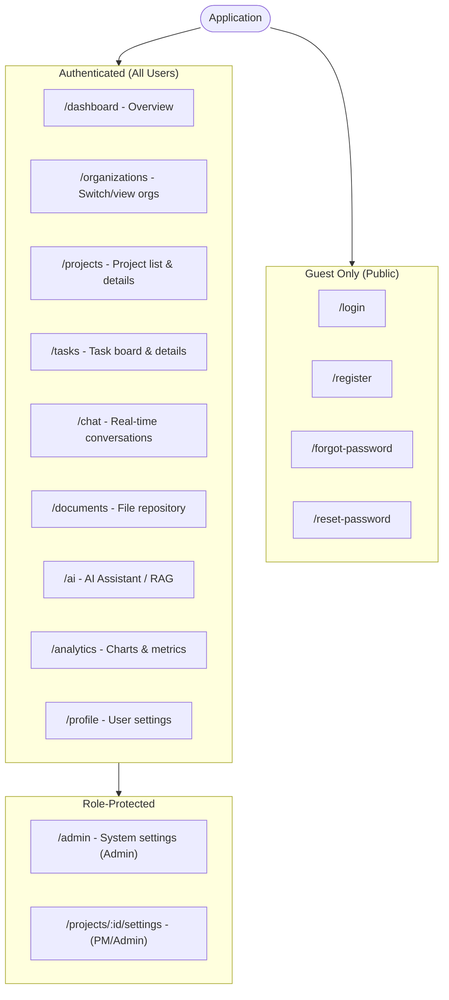

# Application Structure & Navigation

This document defines the sitemap, navigation rules, and layout components for the frontend.

## 1. Sitemap

The application is divided into Public/Guest views, Authenticated Core views, and Role-Protected views.

### Route Map

### Route Table & Permissions

| Path | View | Access Level | Description |
|---|---|---|---|
| `/login` | Login | Guest Only | Authenticate user. Redirects to `/dashboard` if logged in. |
| `/register` | Register | Guest Only | Create new account. |
| `/dashboard` | Dashboard | Authenticated | High-level summary of tasks, recent activity. |
| `/organizations` | Organizations | Authenticated | Organization switcher and member list. |
| `/projects` | Projects | Authenticated | Project board, milestones. |
| `/tasks` | Tasks | Authenticated | List/Kanban of tasks. |
| `/chat` | Chat | Authenticated | Live WebSocket direct and group messaging. |
| `/documents`| Documents | Authenticated | File uploads, previews, downloads. |
| `/ai` | AI Assistant | Authenticated | Document querying and AI conversational interface. |
| `/analytics`| Analytics | Authenticated | Task completion metrics, velocity. |
| `/profile` | Profile | Authenticated | User preferences, security settings. |
| `/admin/*` | Admin Panel | Admin Only | Global user role assignment, audit logs. |

## 2. Navigation Architecture

- **Auth Guard**: Any unauthenticated access to an `Authenticated` route redirects to `/login?redirect={path}`.
- **Guest Guard**: Authenticated users accessing `/login` or `/register` are redirected to `/dashboard`.
- **Role Guard**: Users without the required role (e.g., Member trying to access `/admin`) are redirected to `/dashboard` (or a `403 Forbidden` page).
- **Breadcrumbs**: Dynamic breadcrumbs based on route hierarchy (e.g., `Organizations / Acme / Projects / Apollo`).

## 3. Sidebar (Desktop Navigation)

The sidebar is the primary navigation for desktop (`>= 1024px`).
- **Width**: `240px` (expanded) / `64px` (collapsed/icon-only).
- **Header**: App Logo + Organization Selector dropdown.
- **Main Links**: Dashboard, Projects, Tasks, Chat, Documents, AI, Analytics.
- **Footer Links**: Admin (if applicable), Support/Help, Collapse Toggle.
- **Badges**: Show unread chat messages or pending notifications next to respective links.

## 4. Top Navigation (Header)

The header provides contextual information and global actions.
- **Height**: `64px` (sticky top).
- **Left**: Page Title or Breadcrumb.
- **Center**: Global Search / Command Palette (`Cmd+K`).
- **Right**:
  - Quick AI Toggle
  - Notification Bell (with unread badge)
  - Theme Switcher (Dark/Light)
  - User Avatar & Profile Dropdown (Status indicator, Profile, Settings, Logout).

## 5. Mobile Navigation

Responsive layout for screens `< 1024px`.
- **Bottom Navigation Bar**: 5 fixed items for thumb reach (e.g., Home, Tasks, Chat, AI, Profile).
- **Hamburger Drawer**: Toggled from the top header to reveal the full sidebar (Projects, Documents, Analytics, Admin, Org Switcher).
- **Mobile Header**: Compact header with Page Title, Search Icon, and Notification Bell.
