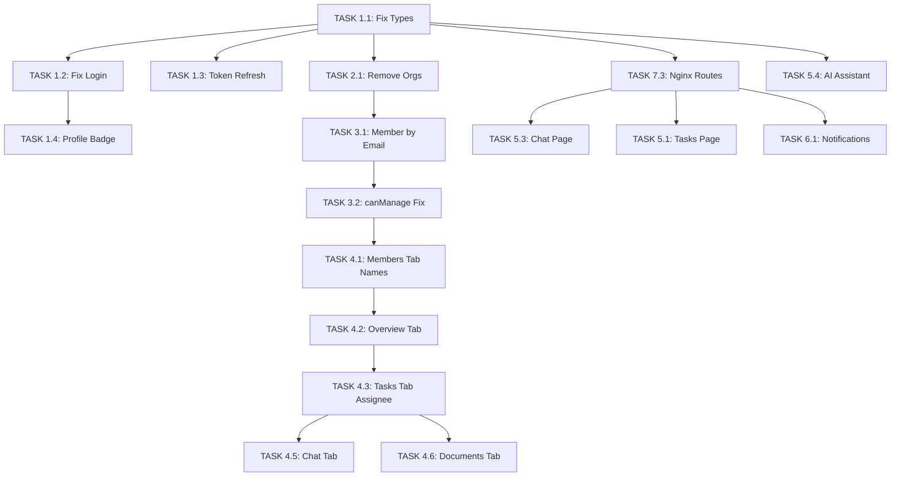

# Frontend Integration Fix Plan
> **Scope:** Frontend-only changes (+ Nginx config if needed). Backend code is read-only.
> **Stack:** React + TypeScript + Vite + Zustand + TailwindCSS
> **Architecture:** Microservices behind an Nginx API Gateway at `https://localhost:8443`

---

## Investigation Summary

After a full audit of the frontend source at [`srcs/frontend/src/`](file:///home/anbaya/Desktop/ft_transcendence/srcs/frontend/src), the backend OpenAPI contract at [`api-endpoints/openapi.yaml`](file:///home/anbaya/Desktop/ft_transcendence/api-endpoints/openapi.yaml), and the Nginx routing at [`srcs/api-gateway/conf/nginx.conf`](file:///home/anbaya/Desktop/ft_transcendence/srcs/api-gateway/conf/nginx.conf), the following critical mismatches, missing features, and mock-data blockers were identified.

---

## Legend
| Symbol | Meaning |
|--------|---------|
| 🔴 | Critical — breaks functionality |
| 🟡 | Important — wrong behavior or data |
| 🟢 | Enhancement — new feature to build |
| ✅ | Completed |

---

## PHASE 1 — Foundation (Types, Auth, API Layer)

> Fix the base layer before touching pages. Everything downstream depends on this being correct.

### TASK 1.1 🔴 — Fix TypeScript Types to match OpenAPI schemas

**Files:** [`src/types/project.ts`](file:///home/anbaya/Desktop/ft_transcendence/srcs/frontend/src/types/project.ts), [`src/types/task.ts`](file:///home/anbaya/Desktop/ft_transcendence/srcs/frontend/src/types/task.ts), [`src/types/document.ts`](file:///home/anbaya/Desktop/ft_transcendence/srcs/frontend/src/types/document.ts), [`src/types/chat.ts`](file:///home/anbaya/Desktop/ft_transcendence/srcs/frontend/src/types/chat.ts), [`src/types/notification.ts`](file:///home/anbaya/Desktop/ft_transcendence/srcs/frontend/src/types/notification.ts)

**Issues Found:**

- **`project.ts`**: Status enum uses `'Planning' | 'Active' | 'On Hold' | 'Completed'` but backend requires `planned | in_progress | completed | cancelled`. Priority enum uses `'Low' | 'Medium' | 'High' | 'Urgent'` but backend only has `low | medium | high`. Contains `organization_id` field that doesn't exist in backend schema.
- **`task.ts`**: Status uses `'Todo' | 'In Progress' | 'In Review' | 'Done'` but backend is `TODO | IN_PROGRESS | COMPLETED`. Priority uses `'Low' | 'Medium' | 'High' | 'Urgent'` but backend is `LOW | MEDIUM | HIGH`. Missing `project_name`, `assignee_name`, `assignee_email` fields.
- **`document.ts`**: Uses wrong field names (`filename`, `file_type`, `file_size`, `uploader_id`, `storage_path`) — backend returns `name`, `project_name`, `uploaded_by_id`, `uploaded_by_name`, `file`, `uploaded_at`.
- **`chat.ts`**: `Message` uses `sent_at` / `conversation_id` / `sender_id` / `content` but backend returns `content` / `created_at` / `sender_id` / `sender_name`. Missing `sender_name`.
- **`notification.ts`**: Uses a frontend `type` field that doesn't exist in backend. Backend returns `title`, `message` (not `content`). Missing `message` field mapping.
- **`ProjectMember` type**: Missing `email`, `first_name`, `last_name`, `role` fields that the backend sends.

**Fix:**
```typescript
// project.ts
export type ProjectStatus = 'planned' | 'in_progress' | 'completed' | 'cancelled';
export type ProjectPriority = 'low' | 'medium' | 'high';
export interface Project {
  id: number;
  name: string;
  description?: string | null;
  start_date?: string | null;
  deadline?: string | null;
  status: ProjectStatus;
  priority: ProjectPriority;
  created_by: number;
  chat_sync_status: 'pending' | 'ready' | 'failed';
  created_at: string;
  updated_at: string;
}
export interface ProjectMember {
  id: number;
  project: number;
  user_id: number;
  email: string;
  first_name: string;
  last_name: string;
  role: 'PROJECT_MANAGER' | 'MEMBER';
  joined_at: string;
}

// task.ts
export type TaskStatus = 'TODO' | 'IN_PROGRESS' | 'COMPLETED';
export type TaskPriority = 'LOW' | 'MEDIUM' | 'HIGH';
export interface Task {
  id: number;
  title: string;
  description?: string | null;
  status: TaskStatus;
  priority: TaskPriority;
  deadline?: string | null;
  project_id: number;
  project_name: string;
  creator_id: number;
  assignee_id?: number | null;
  assignee_name?: string;
  assignee_email?: string;
  created_at: string;
  updated_at: string;
}

// document.ts
export interface Document {
  id: number;
  project_id: number;
  project_name: string;
  uploaded_by_id: number;
  uploaded_by_name: string;
  name: string;
  file: string;
  uploaded_at: string;
}

// chat.ts
export interface Conversation {
  id: number;
  project_id: number;
  project_name?: string;
  created_at: string;
}
export interface Message {
  id: number;
  conversation: number;
  sender_id: number;
  sender_name: string;
  content: string;
  created_at: string;
}

// notification.ts
export interface Notification {
  id: number;
  user_id: number;
  title: string;
  message: string;  // backend uses 'message', not 'content'
  is_read: boolean;
  created_at: string;
}
```

- [ ] **Subtask:** Update all types as above  
- [ ] **Subtask:** Search for all usages of old field names (e.g. `doc.filename`, `notification.content`, `task.status === 'Done'`) and update them across all components

---

### TASK 1.2 🔴 — Fix Login: Fetch user data from `/api/auth/me/` after receiving token

**File:** [`src/pages/auth/LoginPage.tsx`](file:///home/anbaya/Desktop/ft_transcendence/srcs/frontend/src/pages/auth/LoginPage.tsx)

**Issue Found:** The login response from `/api/auth/login/` returns `{ access, refresh }` only — no `user` object. The current code does `const { access, user } = response.data` and falls back to a fake user with `id: 'unknown'`. This means the user object stored in Zustand is always fake.

**Fix:** After receiving the `access` token, immediately call `GET /api/auth/me/` to get the real user, then store both. Also store the `refresh` token for use with token refresh.

```typescript
const response = await apiClient.post('/api/auth/login/', data);
const { access, refresh } = response.data;
const meResponse = await apiClient.get('/api/auth/me/', {
  headers: { Authorization: `Bearer ${access}` }
});
login(meResponse.data, access, refresh);
navigate('/dashboard');
```

**Also:** Update `authStore.ts` to store `refreshToken` in state and in `persist`.

- [ ] **Subtask:** Update `authStore` to add `refreshToken` field  
- [ ] **Subtask:** Update `LoginPage.tsx` to fetch `/api/auth/me/` after login  
- [ ] **Subtask:** Pass `refresh` token to store on login  

---

### TASK 1.3 🔴 — Implement Token Refresh via `/api/auth/refresh/`

**Files:** [`src/services/api/client.ts`](file:///home/anbaya/Desktop/ft_transcendence/srcs/frontend/src/services/api/client.ts), [`src/stores/authStore.ts`](file:///home/anbaya/Desktop/ft_transcendence/srcs/frontend/src/stores/authStore.ts)

**Issue Found:** The response interceptor in `client.ts` currently just calls `logout()` on any 401. This means if the `access` token expires mid-session, the user gets kicked out instead of silently refreshing.

**Fix:** Add a 401 response interceptor that:
1. Intercepts the failed request
2. Attempts `POST /api/auth/refresh/` with the stored refresh token
3. On success: updates the access token in the store, retries the original request
4. On failure: calls `logout()` and redirects to `/auth/login`

Use Axios interceptor queue pattern to prevent multiple concurrent refresh calls.

- [ ] **Subtask:** Add refresh token logic to `client.ts` response interceptor  
- [ ] **Subtask:** Store `refreshToken` in `authStore` with `persist`  
- [ ] **Subtask:** Update `useAuth.ts` to also handle the refresh flow on app init  

---

### TASK 1.4 🟡 — Fix Profile Page: Remove hardcoded "Project Manager" badge

**File:** [`src/pages/profile/ProfilePage.tsx`](file:///home/anbaya/Desktop/ft_transcendence/srcs/frontend/src/pages/profile/ProfilePage.tsx)

**Issue Found (Line 97):**
```tsx
{user?.role === 'ADMIN' ? 'Administrator' : 'Project Manager'}
// ↑ always shows "Project Manager" for non-admins
```
Backend `User` schema only has `role: ADMIN | USER`. Project Manager is a **per-project** role stored in `ProjectMember.role`. The profile badge should show the system role (`USER` → "Member", `ADMIN` → "Administrator").

**Fix:**
```tsx
{user?.role === 'ADMIN' ? 'Administrator' : 'Member'}
```

- [ ] **Subtask:** Update the role badge in `ProfilePage.tsx`  

---

### TASK 1.5 🟡 — Fix Registration Error Display

**File:** [`src/pages/auth/RegisterPage.tsx`](file:///home/anbaya/Desktop/ft_transcendence/srcs/frontend/src/pages/auth/RegisterPage.tsx)

**Issue Found:** Error parsing only checks `err.response?.data?.email?.[0]`. Backend can return field errors for `first_name`, `last_name`, `password` as arrays, plus `detail` for general errors.

**Fix:** Display all field-level validation errors from the backend response, not just email errors. Iterate over `err.response?.data` keys and render each field's array of messages.

- [ ] **Subtask:** Add a utility to parse DRF validation error responses  
- [ ] **Subtask:** Display field-specific errors below each input in `RegisterPage.tsx`  

---

## PHASE 2 — Remove Organizations

### TASK 2.1 🔴 — Remove all Organization references from the frontend

**Files to modify:**
- [`src/routes/AppRoutes.tsx`](file:///home/anbaya/Desktop/ft_transcendence/srcs/frontend/src/routes/AppRoutes.tsx) — remove `/organizations` and `/organizations/:id` routes
- [`src/components/layout/Sidebar.tsx`](file:///home/anbaya/Desktop/ft_transcendence/srcs/frontend/src/components/layout/Sidebar.tsx) — remove organization switcher dropdown, imports from `organizationStore`, all `activeOrganization` UI
- [`src/stores/organizationStore.ts`](file:///home/anbaya/Desktop/ft_transcendence/srcs/frontend/src/stores/organizationStore.ts) — can be deleted or emptied
- [`src/pages/organizations/`](file:///home/anbaya/Desktop/ft_transcendence/srcs/frontend/src/pages/organizations/) — delete `OrganizationListPage.tsx` and `OrganizationDetailsPage.tsx`
- [`src/features/organizations/`](file:///home/anbaya/Desktop/ft_transcendence/srcs/frontend/src/features/organizations/) — delete entire directory
- [`src/types/organization.ts`](file:///home/anbaya/Desktop/ft_transcendence/srcs/frontend/src/types/) — delete if exists
- Any project creation forms that have `organization_id` field

**Issue Found in Sidebar:** The entire top section of the sidebar is dedicated to an "Organization Switcher" dropdown (lines 142–209). It shows "Organizations", "Manage Organizations", "Create Organization" links. All must be removed. Replace the sidebar header with just the app name/logo.

**Fix for Sidebar header:** Replace the org-switcher dropdown with a simple branded header showing "TeamUP" or project name.

- [ ] **Subtask:** Remove org routes from `AppRoutes.tsx`  
- [ ] **Subtask:** Rewrite sidebar header — remove org dropdown, replace with simple app logo  
- [ ] **Subtask:** Remove org store imports from `Sidebar.tsx`  
- [ ] **Subtask:** Delete org pages and feature directories  
- [ ] **Subtask:** Remove `organization_id` from project creation/edit forms  

---

## PHASE 3 — Project Store & API Fixes

### TASK 3.1 🔴 — Fix `addProjectMember` to use email instead of user_id

**File:** [`src/stores/projectStore.ts`](file:///home/anbaya/Desktop/ft_transcendence/srcs/frontend/src/stores/projectStore.ts)

**Issue Found (Line 109):**
```typescript
const response = await apiClient.post(`/api/projects/${projectId}/members/`, { user_id: userId });
```
Backend accepts `{ email: string }` (required), with `user_id` as optional fallback. The UI should accept email input.

**Fix:**
```typescript
addProjectMember: async (projectId: string, email: string) => {
  const response = await apiClient.post(`/api/projects/${projectId}/members/`, { email });
  // ...
}
```

- [ ] **Subtask:** Update `addProjectMember` signature and API call in `projectStore.ts`  
- [ ] **Subtask:** Update `AddProjectMemberModal.tsx` to use email input field  

---

### TASK 3.2 🟡 — Fix canManage logic in ProjectDetailsPage

**File:** [`src/pages/projects/ProjectDetailsPage.tsx`](file:///home/anbaya/Desktop/ft_transcendence/srcs/frontend/src/pages/projects/ProjectDetailsPage.tsx)

**Issue Found (Line 34):**
```typescript
const canManage = user?.role === 'ADMIN' || user?.role === 'PROJECT_MANAGER';
```
`PROJECT_MANAGER` is a **project-level** role from `ProjectMember.role`, not a system-level role. The backend user schema only has `ADMIN | USER`. To determine if the logged-in user is the project manager, compare `user.id` against the member with `role === 'PROJECT_MANAGER'` in `activeProjectMembers`.

**Fix:**
```typescript
const isProjectManager = activeProjectMembers.some(
  m => m.user_id === user?.id && m.role === 'PROJECT_MANAGER'
);
const canManage = user?.role === 'ADMIN' || isProjectManager;
```

- [ ] **Subtask:** Fix `canManage` logic in `ProjectDetailsPage.tsx`  
- [ ] **Subtask:** Apply same fix in `TasksPage.tsx` (currently has same problem)  

---

### TASK 3.3 🟡 — Fix project status/priority enums in Create/Edit Project modals

**Files:** Project creation/edit modals (inside `src/features/projects/components/`)

**Issue Found:** Forms likely use old enum values (`Planning`, `Active`, `High`, `Urgent`). Backend requires lowercase: `planned`, `in_progress`, `completed`, `cancelled` and `low`, `medium`, `high`.

**Fix:** Update all `<select>` or dropdown options to use backend-correct values. When deadline is empty/not set, send `null` (not empty string `""`).

- [ ] **Subtask:** Update status dropdown values in Create/Edit Project forms  
- [ ] **Subtask:** Update priority dropdown values  
- [ ] **Subtask:** Ensure empty deadline sends `null` not `""`  

---

## PHASE 4 — Project Details Page (5 Tabs)

### TASK 4.1 🟡 — Fix Members Tab: Display real names, email, and role

**File:** [`src/pages/projects/ProjectDetailsPage.tsx`](file:///home/anbaya/Desktop/ft_transcendence/srcs/frontend/src/pages/projects/ProjectDetailsPage.tsx)

**Issue Found (Lines 280–292):** The member list shows `"User {member.user_id}"` and `"ID: {member.user_id}"`. The backend's `ProjectMember` object already contains `first_name`, `last_name`, `email`, and `role`.

**Fix:**
```tsx
<p className="font-medium">{member.first_name} {member.last_name}</p>
<p className="text-xs text-muted">{member.email}</p>
// Avatar letter:
{member.first_name?.[0]?.toUpperCase() || 'U'}
// Role badge:
<Badge>{member.role === 'PROJECT_MANAGER' ? 'Project Manager' : 'Member'}</Badge>
```

- [ ] **Subtask:** Replace `user_id` display with real name, email, and role  
- [ ] **Subtask:** Fix avatar initial to use `first_name[0]`  

---

### TASK 4.2 🟡 — Fix Overview Tab: Show creator's name, handle null deadline

**File:** [`src/pages/projects/ProjectDetailsPage.tsx`](file:///home/anbaya/Desktop/ft_transcendence/srcs/frontend/src/pages/projects/ProjectDetailsPage.tsx)

**Issue Found (Line 148):**
```tsx
<p>Due {new Date(project.deadline).toLocaleDateString()} · {activeProjectMembers.length} members</p>
```
`project.deadline` can be `null`. `new Date(null)` returns "Invalid Date". Also, `project.created_by` is an integer ID — not resolved to a name.

**Fix:**
- Null-check `deadline` before rendering: `project.deadline ? new Date(project.deadline).toLocaleDateString() : 'No deadline'`
- Fetch creator name from `activeProjectMembers` where `role === 'PROJECT_MANAGER'` and display it

- [ ] **Subtask:** Handle null deadline in Overview tab (and everywhere it's rendered)  
- [ ] **Subtask:** Display creator/project manager name in Overview  

---

### TASK 4.3 🟡 — Fix Tasks Tab: Task assignment shows only project members by real name

**Files:** [`src/features/tasks/components/CreateTaskModal.tsx`](file:///home/anbaya/Desktop/ft_transcendence/srcs/frontend/src/features/tasks/components/CreateTaskModal.tsx), [`src/features/tasks/components/EditTaskModal.tsx`](file:///home/anbaya/Desktop/ft_transcendence/srcs/frontend/src/features/tasks/components/EditTaskModal.tsx)

**Issues Found:**
- Assignee dropdown likely shows user IDs or mock users
- EditTaskModal likely causes freezing (likely due to uncontrolled form re-renders or missing `key` prop when opening)
- Task status/priority values may be mismatched with backend enums

**Fix:**
- Use `activeProjectMembers` from project store to populate assignee dropdown, displaying `{first_name} {last_name}` and submitting `user_id` as `assignee_id`
- Fix EditTaskModal freeze: ensure modal properly resets form state when `task` prop changes using `useEffect` with `task?.id` as dependency, or use `key={task?.id}` on the modal
- Update status/priority options to match backend enums

- [ ] **Subtask:** Fix assignee dropdown to use project members with real names  
- [ ] **Subtask:** Fix EditTaskModal freeze — add `key={task?.id}` or `useEffect` reset  
- [ ] **Subtask:** Update task status/priority enum values in forms  

---

### TASK 4.4 🟡 — Fix Tasks Tab: Status updates for assigned members

**Files:** [`src/stores/taskStore.ts`](file:///home/anbaya/Desktop/ft_transcendence/srcs/frontend/src/stores/taskStore.ts), [`src/features/tasks/components/TaskTable.tsx`](file:///home/anbaya/Desktop/ft_transcendence/srcs/frontend/src/features/tasks/components/TaskTable.tsx)

**Issue Found (Line 71 taskStore.ts):**
```typescript
await apiClient.patch(`/api/tasks/tasks/${taskId}/status/`, { status: backendStatus });
```
The URL is `/api/tasks/tasks/...` which becomes `/api/tasks/tasks/` after nginx strips `/api/tasks/` prefix. This creates `/tasks/{id}/status/` at the task service — check if this is correct. According to OpenAPI spec, the correct path is `/api/tasks/{id}/status/`.

**Fix:** The nginx config strips `/api/tasks/` and proxies to `task-service:8000`. So the backend receives `/tasks/{id}/status/`. Verify this is a valid route on the task service. If not, correct the URL to `/api/tasks/{id}/status/`.

Also, the status map needs updating:
```typescript
const statusMap = {
  'TODO': 'TODO',
  'IN_PROGRESS': 'IN_PROGRESS',
  'COMPLETED': 'COMPLETED',
};
```

- [ ] **Subtask:** Audit and fix task API URL paths (status, assignee, delete)  
- [ ] **Subtask:** Update status map to use backend enums directly  
- [ ] **Subtask:** Ensure assigned member can update their task status (permission check in UI)  

---

### TASK 4.5 🟢 — Add Chat Tab to Project Details

**File:** [`src/pages/projects/ProjectDetailsPage.tsx`](file:///home/anbaya/Desktop/ft_transcendence/srcs/frontend/src/pages/projects/ProjectDetailsPage.tsx)

**Current State:** Project Details only has 3 tabs: Overview, Tasks, Members. Chat and Documents tabs are missing.

**Required:** Add a "Chat" tab that:
1. Calls `GET /api/conversations/projects/{project_id}/` to get or create conversation
2. Calls `GET /api/conversations/{conversation_id}/messages/` for message history
3. Opens a WebSocket to `wss://localhost:8443/ws/projects/{project_id}/chat/?token={access_token}`
4. Inbound WS frame: `{ "message": "Hello" }`
5. Outbound WS frame: `{ "type": "chat_message", "id": 1, "sender_id": 2, "sender_name": "John Doe", "message": "Hello", "created_at": "..." }`
6. Prevents duplicate messages (check by `id`)

**Critical WS Note:** The current `wsClient` in `services/websocket/client.ts` is a singleton using a generic URL. For project chat, each project needs its own connection to `/ws/projects/{project_id}/chat/`. Create a per-project WebSocket connection, not the global singleton.

- [ ] **Subtask:** Create `ProjectChatTab.tsx` component  
- [ ] **Subtask:** Implement project-specific WebSocket connection  
- [ ] **Subtask:** Add deduplication for incoming messages  
- [ ] **Subtask:** Add Chat tab to `ProjectDetailsPage.tsx`  

---

### TASK 4.6 🟢 — Add Documents Tab to Project Details

**File:** [`src/pages/projects/ProjectDetailsPage.tsx`](file:///home/anbaya/Desktop/ft_transcendence/srcs/frontend/src/pages/projects/ProjectDetailsPage.tsx)

**Required:** Add a "Documents" tab that:
1. Calls `GET /api/documents/projects/{project_id}/documents/` to list documents
2. Upload: `POST /api/documents/projects/{project_id}/documents/` with `FormData` containing `file` (binary) and `name` (string) — backend auto-links to project
3. Download: Authenticated `GET /api/documents/{id}/download/` — must include `Authorization: Bearer {token}` header (NOT `window.location.href` which can't send auth headers)

**Issue Found in DocumentsPage.tsx (Line 46):**
```typescript
window.location.href = `/api/documents/documents/${id}/download/`;
```
This doesn't include auth headers → will get a 401. Must use `apiClient.get()` with `responseType: 'blob'` and create a temporary download link.

**Fix for download:**
```typescript
const response = await apiClient.get(`/api/documents/${id}/download/`, { responseType: 'blob' });
const url = window.URL.createObjectURL(response.data);
const link = document.createElement('a');
link.href = url;
link.download = doc.name;
link.click();
window.URL.revokeObjectURL(url);
```

- [ ] **Subtask:** Create `ProjectDocumentsTab.tsx` component  
- [ ] **Subtask:** Fix document download to use authenticated request  
- [ ] **Subtask:** Fix upload to send `FormData` with both `file` and `name` fields  
- [ ] **Subtask:** Add Documents tab to `ProjectDetailsPage.tsx`  

---

## PHASE 5 — Main Sidebar Pages

### TASK 5.1 🔴 — Fix Tasks Page: Show only assigned tasks, remove Create button, use correct API

**File:** [`src/pages/tasks/TasksPage.tsx`](file:///home/anbaya/Desktop/ft_transcendence/srcs/frontend/src/pages/tasks/TasksPage.tsx)

**Issues Found:**
1. Shows a "Create Task" button for project managers (line 89) — should be removed from this global page
2. Fetches from `fetchProjectTasks(activeProject.id)` when `activeProject` exists — global Tasks page should ONLY show tasks assigned to the current user, always
3. `fetchMyTasks()` stores data in `myTasks` but the table renders `tasks` (line 110) — wrong state
4. Filter logic uses old status/priority values

**Fix:**
- Always call `fetchMyTasks()` on mount (never `fetchProjectTasks`)
- Render `myTasks` in the table, not `tasks`
- Remove "Create Task" button entirely
- Show `project_name` column (already in Task schema)
- Update filter options to use backend enum values
- Allow status update inline (user can update their own task status)

- [ ] **Subtask:** Remove "Create Task" button from `TasksPage.tsx`  
- [ ] **Subtask:** Always use `fetchMyTasks()` and render `myTasks` state  
- [ ] **Subtask:** Show `project_name` in task table  
- [ ] **Subtask:** Update filter options to use `TODO | IN_PROGRESS | COMPLETED`  

---

### TASK 5.2 🟡 — Fix Documents Page: Show all user's documents, remove Upload button, use `/api/documents/my/`

**File:** [`src/pages/documents/DocumentsPage.tsx`](file:///home/anbaya/Desktop/ft_transcendence/srcs/frontend/src/pages/documents/DocumentsPage.tsx)

**Issues Found:**
1. Global "Upload File" button should be removed from global documents page
2. Fetches `fetchDocuments(String(activeProject.id))` — only fetches for the active project. Should use `/api/documents/my/` to get all user documents across all projects
3. Renders `doc.filename` (wrong field) — backend returns `doc.name`
4. Download doesn't send auth header

**Fix:**
- Fetch from `/api/documents/my/` on mount
- Show `project_name` column per document
- Remove global "Upload File" button
- Fix download to use authenticated fetch
- Fix field name `filename` → `name`

- [ ] **Subtask:** Add `fetchMyDocuments()` action to `documentStore.ts` calling `/api/documents/my/`  
- [ ] **Subtask:** Update `DocumentsPage.tsx` to use `fetchMyDocuments()` on mount  
- [ ] **Subtask:** Remove "Upload File" button from global documents page  
- [ ] **Subtask:** Show `project_name` column in documents table  
- [ ] **Subtask:** Fix all `doc.filename` references to `doc.name`  
- [ ] **Subtask:** Fix document download to use `apiClient` with blob response  

---

### TASK 5.3 🟢 — Fix Chat Page: Show all conversations, use real project names

**File:** [`src/pages/chat/ChatPage.tsx`](file:///home/anbaya/Desktop/ft_transcendence/srcs/frontend/src/pages/chat/ChatPage.tsx)

**Issue Found:** The global Chat page only loads the chat for `activeProject` (line 22–28). If no project is active, it shows nothing. The page should:
1. Fetch ALL user conversations from `GET /api/conversations/my/`
2. Show them in a list with `project_name`, last message, timestamp
3. On selecting a conversation, load its messages and open a project-specific WebSocket
4. **Share the same WebSocket/message state** as the Project Details Chat tab (same conversation IDs)

- [ ] **Subtask:** Add `fetchMyConversations()` to a chat store/service calling `/api/conversations/my/`  
- [ ] **Subtask:** Update `ChatPage.tsx` to show all conversations on load  
- [ ] **Subtask:** Display `project_name` in conversation list  
- [ ] **Subtask:** On conversation select, connect to `wss://host/ws/projects/{project_id}/chat/?token={token}`  
- [ ] **Subtask:** Ensure no duplicate messages when WS message arrives  

---

### TASK 5.4 🟢 — Rebuild AI Assistant: Connect to `/api/ai/ask/` with project selector

**File:** [`src/stores/aiStore.ts`](file:///home/anbaya/Desktop/ft_transcendence/srcs/frontend/src/stores/aiStore.ts), [`src/features/ai/components/AIChat.tsx`](file:///home/anbaya/Desktop/ft_transcendence/srcs/frontend/src/features/ai/components/), [`src/pages/ai/AIAssistantPage.tsx`](file:///home/anbaya/Desktop/ft_transcendence/srcs/frontend/src/pages/ai/AIAssistantPage.tsx)

**Issue Found:** `aiStore.ts` is entirely mock data with a simulated timeout (line 130). It never calls any backend API.

**Fix:** Rewrite `sendMessage()` to call real API:
```typescript
sendMessage: async (content: string, projectId?: string | null) => {
  const body: any = { question: content };
  if (projectId) body.project_id = Number(projectId);
  const response = await apiClient.post('/api/ai/ask/', body);
  // response.data.answer is markdown string
  // response.data.mode is 'general' | 'project'
}
```

**Add project selector:**
- Fetch user's projects from `projectStore`
- Add a dropdown with "General" + each project name
- Pass selected `project_id` (or `null` for General) with each message
- Render `response.data.answer` as Markdown (use `react-markdown` or similar)

- [ ] **Subtask:** Rewrite `aiStore.sendMessage()` to call `POST /api/ai/ask/`  
- [ ] **Subtask:** Remove all mock data and conversations from `aiStore.ts`  
- [ ] **Subtask:** Add project selector to AI page/component  
- [ ] **Subtask:** Render AI responses as Markdown  
- [ ] **Subtask:** Fetch conversation history from `/api/ai/history/` on load  

---

### TASK 5.5 🟡 — Analytics Page: Verify project selector and endpoint

**File:** `src/pages/analytics/AnalyticsPage.tsx`, [`src/stores/analyticsStore.ts`](file:///home/anbaya/Desktop/ft_transcendence/srcs/frontend/src/stores/analyticsStore.ts)

**Check:** Verify analytics calls `GET /api/projects/{id}/analytics/` and renders real data from the response schema (`total_tasks`, `completed_tasks`, `in_progress_tasks`, `todo_tasks`, `completion_rate`).

- [ ] **Subtask:** Verify analytics API call uses correct endpoint  
- [ ] **Subtask:** Verify analytics data fields match backend response  

---

## PHASE 6 — Notifications

### TASK 6.1 🔴 — Fix "Mark All as Read" to call backend + update counter

**File:** [`src/stores/notificationStore.ts`](file:///home/anbaya/Desktop/ft_transcendence/srcs/frontend/src/stores/notificationStore.ts)

**Issue Found (Line 53):** `markAllAsRead()` only updates local state — it never calls the backend `POST /api/notifications/read-all/`. After a refresh, all notifications revert to unread.

**Fix:**
```typescript
markAllAsRead: async () => {
  await apiClient.post('/api/notifications/read-all/');
  set(state => ({
    notifications: state.notifications.map(n => ({ ...n, is_read: true })),
    unreadCount: 0,
  }));
}
```

- [ ] **Subtask:** Make `markAllAsRead` async and call `/api/notifications/read-all/`  
- [ ] **Subtask:** Make the function signature `async` in the interface  

---

### TASK 6.2 🟡 — Fix Notification display: use `message` field, display real content

**Files:** [`src/pages/notifications/NotificationsPage.tsx`](file:///home/anbaya/Desktop/ft_transcendence/srcs/frontend/src/pages/notifications/NotificationsPage.tsx), [`src/types/notification.ts`](file:///home/anbaya/Desktop/ft_transcendence/srcs/frontend/src/types/notification.ts)

**Issue Found (Line 141):**
```tsx
<p>{notification.content}</p>
```
Backend sends `notification.message` not `notification.content`. This renders nothing.

**Fix:** Change to `notification.message`. Also, the backend doesn't send a `type` field — the `getIcon()` function should be removed or display a generic icon.

- [ ] **Subtask:** Replace `notification.content` with `notification.message`  
- [ ] **Subtask:** Remove or simplify `getIcon()` since backend has no `type` field  
- [ ] **Subtask:** Ensure notifications update in real-time (add WebSocket notification listener if chat WS broadcasts them)  

---

### TASK 6.3 🟡 — Fetch notifications on app load and keep counter live

**Files:** `src/components/layout/NotificationNav.tsx`, `src/stores/notificationStore.ts`

**Issue Found:** Notifications may not be fetched on initial app load or refreshed periodically.

**Fix:** Call `fetchNotifications()` in `useAuth.ts` after session is validated, or in the layout component on mount. The `unreadCount` should derive from `notifications.filter(n => !n.is_read).length`.

- [ ] **Subtask:** Call `fetchNotifications()` on app init after auth is confirmed  
- [ ] **Subtask:** Verify notification counter updates after marking as read  

---

## PHASE 7 — Technical / Infrastructure

### TASK 7.1 🔴 — Fix WebSocket: Per-project connections, correct message format

**File:** [`src/services/websocket/client.ts`](file:///home/anbaya/Desktop/ft_transcendence/srcs/frontend/src/services/websocket/client.ts)

**Issues Found:**
1. The singleton `wsClient` connects to a generic `/ws/` URL. Backend WS endpoint is `/ws/projects/{project_id}/chat/`
2. WS messages inbound to server should be: `{ "message": "text" }` (not `{ type, payload }`)
3. WS messages FROM server have: `{ "type": "chat_message", "id", "sender_id", "sender_name", "message", "created_at" }`
4. The current `onmessage` handler reads `data.payload` but server sends flat object

**Fix:** Create a `createProjectWebSocket(projectId, token)` factory function that returns a per-project WS connection. Update the message send format to match backend expectation.

- [ ] **Subtask:** Refactor WebSocket client to support per-project connections  
- [ ] **Subtask:** Fix inbound message format to `{ "message": "text" }`  
- [ ] **Subtask:** Fix outbound message parsing to read server's flat format  
- [ ] **Subtask:** Add duplicate message prevention by checking `message.id`  

---

### TASK 7.2 🟡 — Audit and fix all API URL paths

**Known issues from investigation:**

| Current URL | Issue | Correct URL |
|-------------|-------|-------------|
| `/api/tasks/tasks/${id}/status/` | Double `tasks` — becomes `/tasks/tasks/{id}/status/` at task-service | `/api/tasks/${id}/status/` |
| `/api/tasks/tasks/${id}/assignee/` | Same double-prefix issue | `/api/tasks/${id}/assignee/` |
| `/api/tasks/tasks/${id}/` (delete) | Same issue | `/api/tasks/${id}/` |
| `/api/tasks/projects/${id}/tasks/` | Becomes `/projects/{id}/tasks/` at task-service | Need to verify if task-service has this route |
| `/api/tasks/users/me/tasks/` | Becomes `/users/me/tasks/` at task-service | Verify with backend team |
| `window.location.href` for download | Can't send auth headers | Use `apiClient` with `responseType: blob` |

**Also verify in nginx.conf:** The current config strips `/api/tasks/` prefix (using `proxy_pass http://$task_upstream/`). This means `/api/tasks/foo` becomes `/foo` at the task-service. Confirm all task URLs are routed correctly.

- [ ] **Subtask:** Audit all API calls in `taskStore.ts` against nginx routing  
- [ ] **Subtask:** Fix double-prefix task URLs  
- [ ] **Subtask:** Add a missing `/api/conversations/` route to nginx if needed  
- [ ] **Subtask:** Add `/api/notifications/` route to nginx config if missing  

> **Note:** Check nginx.conf — it currently has routes for `/api/auth/`, `/api/projects/`, `/api/tasks/`, `/api/documents/`, `/api/ai/`, `/ws/`. It is **missing** routes for `/api/conversations/` and `/api/notifications/`. These need to be added pointing to `chat-service:8000`.

---

### TASK 7.3 🔴 — Add missing nginx routes for conversations and notifications

**File:** [`srcs/api-gateway/conf/nginx.conf`](file:///home/anbaya/Desktop/ft_transcendence/srcs/api-gateway/conf/nginx.conf)

**Issue Found:** The nginx config has no routing for:
- `/api/conversations/` — needed for chat REST API
- `/api/notifications/` — needed for notification REST API
- `/api/users/` — needed for `/api/users/me/tasks/` alias

Both conversations and notifications are served by the `chat-service`. 

**Fix — add to nginx.conf:**
```nginx
location /api/conversations/ {
    set $chat_upstream chat-service:8000;
    proxy_pass http://$chat_upstream/;
    proxy_set_header Host $host;
    proxy_set_header X-Real-IP $remote_addr;
}

location /api/notifications/ {
    set $chat_upstream chat-service:8000;
    proxy_pass http://$chat_upstream/;
    proxy_set_header Host $host;
    proxy_set_header X-Real-IP $remote_addr;
}

location /api/users/ {
    set $task_upstream task-service:8000;
    proxy_pass http://$task_upstream/;
    proxy_set_header Host $host;
    proxy_set_header X-Real-IP $remote_addr;
}
```

- [ ] **Subtask:** Add `/api/conversations/` proxy in nginx.conf → `chat-service:8000`  
- [ ] **Subtask:** Add `/api/notifications/` proxy in nginx.conf → `chat-service:8000`  
- [ ] **Subtask:** Add `/api/users/` proxy in nginx.conf → `task-service:8000`  
- [ ] **Subtask:** Rebuild `api-gateway` container after nginx change (`make up`)  

---

### TASK 7.4 🟡 — Add loading indicators and success/error toast system

**Files:** Multiple pages and stores

**Issue Found:** Most errors use `console.error()` or no UI feedback at all. `ProfilePage` uses `alert()`. There's no toast/snackbar system.

**Fix:** Install or build a simple toast notification system and use it across:
- Task create/update/delete
- Member add/remove
- Document upload/delete
- Project create/update/delete
- Auth errors

- [ ] **Subtask:** Add a toast/notification UI component (use `react-hot-toast` or build a simple one)  
- [ ] **Subtask:** Replace `alert()` calls with toast notifications  
- [ ] **Subtask:** Add success toasts for all async actions  
- [ ] **Subtask:** Add error toasts parsing DRF error responses  

---

### TASK 7.5 🟡 — Never display technical IDs in the UI

**Files:** Multiple

**Violations found:**
- `ProjectDetailsPage.tsx` line 283: `<p>ID: {member.user_id}</p>`
- Any places where numeric IDs appear in rendered text

**Fix:** Audit all `.tsx` files for patterns like `{member.user_id}`, `{task.id}`, `{project.id}` used as display text (not as keys or in API calls). Replace with human-readable names.

- [ ] **Subtask:** Grep for `user_id` / `project_id` / `.id` rendered as text in JSX  
- [ ] **Subtask:** Replace all ID display with names  

---

## Execution Order



**Recommended execution phases:**
1. **Day 1:** Tasks 1.1, 7.3 (types + nginx — foundation everything else depends on)
2. **Day 2:** Tasks 1.2, 1.3, 1.4, 1.5, 2.1 (auth + org removal)
3. **Day 3:** Tasks 3.x, 4.1, 4.2, 4.3, 4.4 (project store + existing tabs fixes)
4. **Day 4:** Tasks 4.5, 4.6 (new Chat & Documents tabs in project details)
5. **Day 5:** Tasks 5.1, 5.2, 5.3, 5.4, 5.5 (sidebar pages)
6. **Day 6:** Tasks 6.x, 7.x (notifications + technical polish)

---

## Files Summary

| File | Action |
|------|--------|
| `src/types/project.ts` | Rewrite enums + fields |
| `src/types/task.ts` | Rewrite enums + add missing fields |
| `src/types/document.ts` | Rewrite fields to match backend |
| `src/types/chat.ts` | Fix Message schema |
| `src/types/notification.ts` | Add `message` field, remove `type` |
| `src/stores/authStore.ts` | Add `refreshToken` field |
| `src/stores/projectStore.ts` | Fix `addProjectMember` to use email |
| `src/stores/taskStore.ts` | Fix URLs, fix status map |
| `src/stores/documentStore.ts` | Add `fetchMyDocuments()` |
| `src/stores/notificationStore.ts` | Make `markAllAsRead` async + call API |
| `src/stores/aiStore.ts` | Rewrite with real API, remove mocks |
| `src/services/api/client.ts` | Add token refresh interceptor |
| `src/services/websocket/client.ts` | Refactor for per-project connections |
| `src/pages/auth/LoginPage.tsx` | Fetch `/api/auth/me/` after login |
| `src/pages/auth/RegisterPage.tsx` | Parse all field-level errors |
| `src/pages/profile/ProfilePage.tsx` | Fix role badge |
| `src/pages/projects/ProjectDetailsPage.tsx` | Fix canManage, names, add Chat & Docs tabs |
| `src/pages/tasks/TasksPage.tsx` | Use `myTasks`, remove Create button |
| `src/pages/documents/DocumentsPage.tsx` | Use `fetchMyDocuments`, fix download, remove upload |
| `src/pages/chat/ChatPage.tsx` | Fetch all conversations from `/api/conversations/my/` |
| `src/pages/notifications/NotificationsPage.tsx` | Fix `message` field |
| `src/pages/ai/AIAssistantPage.tsx` | Add project selector |
| `src/components/layout/Sidebar.tsx` | Remove org switcher |
| `src/routes/AppRoutes.tsx` | Remove org routes |
| `src/pages/organizations/` | Delete entirely |
| `src/features/organizations/` | Delete entirely |
| `srcs/api-gateway/conf/nginx.conf` | Add conversations, notifications, users routes |
| `src/features/projects/components/AddProjectMemberModal.tsx` | Use email input |
| `src/features/tasks/components/EditTaskModal.tsx` | Fix freeze with key or useEffect |
| `src/features/tasks/components/CreateTaskModal.tsx` | Fix assignee dropdown |
